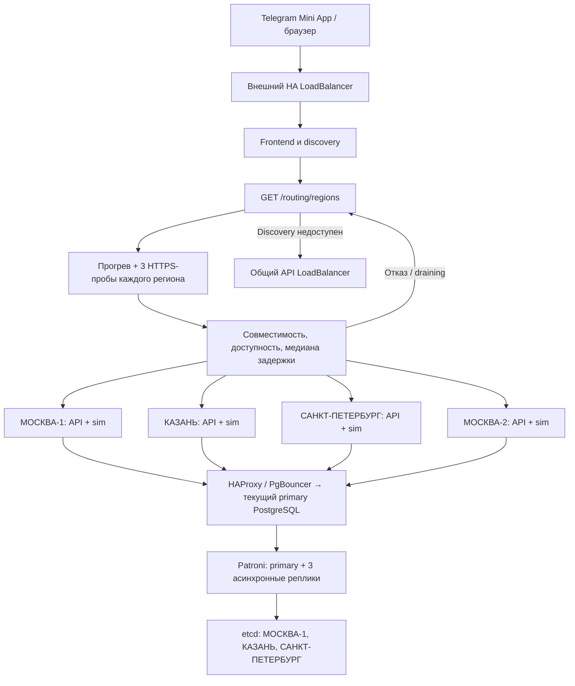

# Моспром: безопасная поставка и распределённое развёртывание

Система готова к развёртыванию на распределённой инфраструктуре и поддерживает **горизонтальное и вертикальное масштабирование серверной части игры**. В репозитории находятся конфигурации, инструменты доставки и проверки. Подключение реальных серверов, DNS, LoadBalancer, сертификатов и секретов выполняется через inventory; статус испытаний указан в [VALIDATION.md](VALIDATION.md).

**Статус выпуска:** функциональные проверки пройдены, но публикация заблокирована High-находками в базовых образах Python/Caddy; подробности и пределы приёмки — в [VALIDATION.md](VALIDATION.md).

Доступны два варианта: одна VM с Docker Compose и распределённая система с PostgreSQL/Patroni. Референсный пример — **МОСКВА-1, КАЗАНЬ, САНКТ-ПЕТЕРБУРГ и МОСКВА-2**, объединённые WireGuard и внешним отказоустойчивым **LoadBalancer**.



## Как frontend выбирает дата-центр

При запуске frontend запрашивает через LoadBalancer список доступных региональных API: **МОСКВА-1, КАЗАНЬ, САНКТ-ПЕТЕРБУРГ и МОСКВА-2**. Клиент проверяет доступность и задержку HTTPS-запросов, выбирает подходящий дата-центр и направляет туда игровые запросы. При отказе соединения выполняется контролируемое переключение с сохранением правил идемпотентности.

Это выбор маршрута подключения браузера. Экземпляры приложения развёртываются средствами CD. Региональные HTTPS-адреса ведут строго в свою площадку; измерение не должно заканчиваться на общем CDN или другом регионе.

- Discovery: `GET /routing/regions`, каталог TTL 60 секунд, состояния `ready`, `draining`, `unavailable`. В публичном ответе нет внутренних адресов.
- Проверка: `GET /routing/ping?nonce=...`, без Telegram initData, cookies и авторизации; `Cache-Control: no-store`.
- Один прогревочный и три измерительных запроса, параллельно между регионами. Требуются минимум два успешных замера. Выбор: серия без ошибок → меньшая медиана → стабильный ID.
- «Пинг» — длительность небольшого HTTPS-запроса до регионального API, включая обработку ответа; не ICMP и не гарантия задержки игровой команды.
- Проба ограничена одной секундой, серия — четырьмя, discovery — ещё одной. Здоровый маршрут меняется при улучшении одновременно на 20% и 30 мс, не чаще раза в пять минут.
- Смена сети, два последовательных транспортных отказа, возврат после длительного отсутствия и обновление каталога вызывают переоценку на безопасной границе запросов. В скрытой вкладке пробы не выполняются.
- При недоступности discovery используется общий API LoadBalancer. Production не переключается на локальную игровую модель.
- Все адреса проверяются по доверенной HTTPS-зоне. Авторизованные запросы запрещают HTTP redirects. CORS и CSP ограничивают допустимые источники.
- Во время rolling update каталог содержит фактическую ревизию каждого региона. API отвергает несовместимый frontend кодом `426 client_update_required` до обработки игровых запросов.

## Что масштабируется

| Компонент | Горизонтально | Вертикально |
|---|---|---|
| API | несколько экземпляров и площадок | CPU/RAM, `API_WORKERS`, пулы соединений |
| sim | несколько экземпляров за HAProxy | CPU/RAM, `SIM_WORKERS`, лимиты контейнера |
| PostgreSQL | реплики Patroni для отказоустойчивости | CPU/RAM, диски, настройки PostgreSQL |
| Redis | primary, реплики и три Sentinel | RAM и лимиты |
| Бот / планировщик | резервные экземпляры, один активный lease | ресурсы активного экземпляра |

Общее состояние игры хранится в одном PostgreSQL primary. Выбор региона не создаёт отдельную копию аккаунта. Реплики Patroni не обеспечивают линейный рост производительности записи. Асинхронный режим повышает доступность и допускает потерю последних подтверждённых изменений при аварии; **RPO=0 не заявляется**. `maximum_lag_on_failover` ограничивает допустимое отставание, но не является гарантией RPO в секундах. Потеря кворума останавливает безопасное автоматическое избрание.

## Поставка

1. CI frontend проверяет код и открывает PR с обновлением submodule backend.
2. Backend проверяет API, bot, sim, контракт, миграции и настоящий HTTP-клиент. API и бот тестируются в отдельных Python-окружениях из-за разных ограничений Pydantic.
3. Четыре образа одного backend SHA и frontend SHA сканируются, публикуются без повторной сборки, получают SBOM/provenance и подписи cosign.
4. Один PR в deploy содержит весь релиз: digest, SHA исходников, конфигурацию и совместимость миграций.
5. После проверок `main` релиз автоматически поступает на staging. Production запускается вручную и принимает только тот же манифест с успешной записью staging в GitHub Deployments.

CI использует GitHub-hosted раннеры. Доверенный `mosprom-cd` изолирован от PR. Сборки, публикация и PR не имеют доступа к серверам. Production и staging имеют разные базы, ботов и секреты. Все коммиты, включая служебные PR, используют автора из `.github/commit-author.json`.

## Первый запуск

Начните с [RUNBOOK.md](RUNBOOK.md): там указаны bootstrap GitHub App, инфраструктурных образов, secrets, CODEOWNERS, одиночного стенда и HA-профиля. Порядок важен: frontend → submodule/backend → полный релиз → staging → production.

```sh
python -m venv .venv
.venv/bin/pip install --require-hashes -r requirements.lock
.venv/bin/python scripts/validate.py
.venv/bin/pytest -q
.venv/bin/python scripts/check_compose.py
```

Справка: [маршрутизация](docs/routing.md), [HA и сертификаты](docs/ha.md), [эксплуатация и восстановление](RUNBOOK.md), [результаты проверок](VALIDATION.md).

Локальные результаты: frontend 844 passed + 1 разрешённый skip, API 811, bot 105, контракт 200, sim 104, Docker E2E 251, deploy 19. Выбор региона и отрицательные проверки подписи моделировались; перезапуски одноузлового Docker-стенда выполнялись фактически. Реальные четыре площадки, PITR и нагрузочные серии ещё не испытаны.
