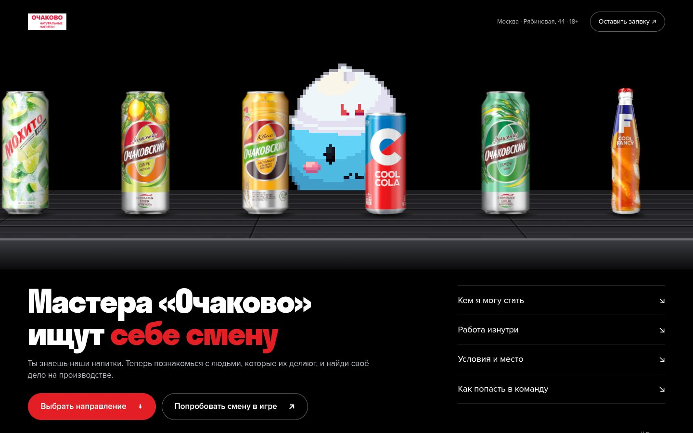
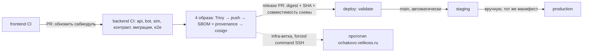
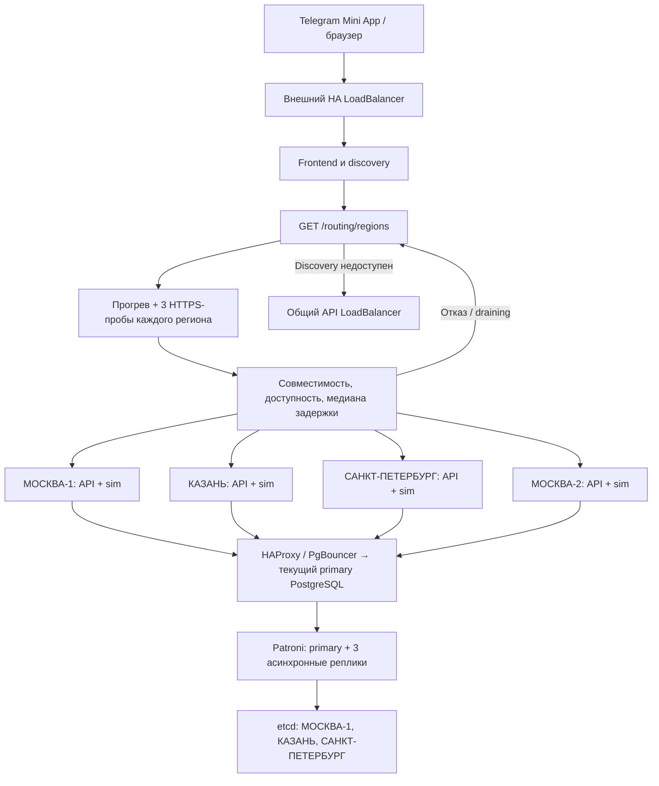

<div align="center">

# Смена на Очаково · deploy

**Поставка и развёртывание Mini App «Очаково»: подписанные образы, релиз одним манифестом, staging → production, живой прототип для жюри и референсный распределённый профиль на четырёх площадках с Patroni**

<sub>Хакатон **Открой#Моспром** · кейс «Очаково» — [github.com/cvn-mosprom](https://github.com/cvn-mosprom)</sub>

<!--STATS-->
**1** живой стенд &nbsp;·&nbsp; **4** площадки в референсе &nbsp;·&nbsp; **4** подписанных образа на релиз &nbsp;·&nbsp; **7** workflow &nbsp;·&nbsp; **3** playbook Ansible &nbsp;·&nbsp; **0** High/Critical в Trivy
<!--/STATS-->

[Прототип для жюри](#прототип-для-жюри) · [Локальный запуск](#локальный-запуск) · [Как устроена поставка](#как-устроена-поставка) · [Выбор дата-центра](#как-клиент-выбирает-дата-центр) · [Масштабирование](#что-масштабируется) · [Состав](#состав-репозитория) · [Проверки](#что-проверено) · [Ограничения](#ограничения-и-честные-границы)



*Живой прототип — https://ochakovo.velikoss.ru: лендинг на `/`, игра на `/app`, демо-CRM на `/hr`, бот [@cvnprombot](https://t.me/cvnprombot).*

</div>

## Почему это интересно

* **Релиз — один манифест.** Четыре образа (api, bot, sim, web) одного SHA бэкенда и фронтенда сканируются, публикуются без пересборки, получают SBOM, provenance и подписи cosign; один PR в `deploy` содержит весь релиз: digest, исходные SHA, конфигурацию и совместимость миграций.
* **Production только после staging того же манифеста.** После проверок `main` релиз сам уезжает на staging; production запускается вручную и принимает ровно тот манифест, у которого есть успешная запись staging в GitHub Deployments.
* **Сборки не видят серверов.** CI идёт на GitHub-hosted раннерах; доверенный раннер `mosprom-cd` изолирован от PR и произвольных workflow. У production и staging разные базы, боты и секреты; секреты живут на серверах и в Ansible Vault, не в Git и не в build args.
* **CD прототипа через forced command.** Доставка на живой стенд идёт по SSH ключом с `restrict` и принудительной командой: без shell, PTY и форвардинга, сервер принимает только ограниченный JSON, сам перепроверяет подписи, делает дамп перед миграциями и обновляет только приложение.
* **Клиент сам выбирает ближайший дата-центр.** Discovery отдаёт список регионов, браузер меряет HTTPS-задержку, выбирает площадку и при отказе переключается с сохранением правил идемпотентности; несовместимый клиент получает `426 client_update_required` до обработки игровых запросов.
* **Честные границы.** RPO=0 не заявляется, четыре площадки — референсный inventory, а не серверы в этих городах; что проверено фактически, а что моделировалось — в [`VALIDATION.md`](VALIDATION.md) и [`PROTOTYPE-VALIDATION.md`](PROTOTYPE-VALIDATION.md).

## Прототип для жюри

Отдельный односерверный профиль `mosprom-prototype` (4 vCPU / 8 ГБ, Санкт-Петербург), без Patroni и независимый от других проектов на хосте.

| Адрес | Что это |
|---|---|
| https://ochakovo.velikoss.ru/ | карьерный лендинг |
| https://ochakovo.velikoss.ru/app | игра; в Telegram — через подписанный initData, во внешнем браузере — ссылка на бота |
| https://ochakovo.velikoss.ru/hr | демо-CRM подбора на синтетических данных, код `123456` |
| https://ochakovo.velikoss.ru/ready | готовность: БД, миграции, Redis, sim, prod-конфигурация |
| https://t.me/cvnprombot | бот: `/start` → кнопка игры, `WEBAPP_URL=…/app` |

```bash
curl -s https://ochakovo.velikoss.ru/ready
```

```json
{"status":"ready","checks":{"db":"ok","migrations":"ok","redis":"ok","sim":"ok","media":"skipped: MEDIA_URL missing","config":"ok"}}
```

`media` пропущен намеренно: в прототипе медиа лежат в web-образе. `/routing/ping` возвращает `regionId=spb`, `apiVersion=1` и ID фактически развёрнутого CD-релиза.

* **Изоляция.** Свой Compose-проект, свои тома и роли PostgreSQL (API и миграции — разные ограниченные роли), БД не публикуется на хост, `/internal` и `/metrics` закрыты снаружи, `X-Dev-User` отвергается (`DEV_AUTH=0`).
* **TLS** завершает общий Caddy хоста (Let's Encrypt), сайт проксируется на `127.0.0.1:18081`.
* **Telegram через прокси.** Bot API напрямую недоступен — бот ходит через `systemd-socket-proxyd` на адресе Docker-bridge к существующему HTTP-прокси; новых VPN и изменения маршрутов не потребовалось.
* **Бэкапы** — сразу и каждые 6 часов, хранятся 7 суток; проверка восстановления `prototype-restore-check.py` поднимает временную БД и API, проверяет readiness и bootstrap и удаляет только свои ресурсы.

Подробно: эксплуатация — [`PROTOTYPE.md`](PROTOTYPE.md), CD из infra-веток — [`PROTOTYPE-CD.md`](PROTOTYPE-CD.md), что проверено на сервере — [`PROTOTYPE-VALIDATION.md`](PROTOTYPE-VALIDATION.md).

**CD прототипа включён и проверен фактически.** [Актуальный успешный выпуск](https://github.com/cvn-mosprom/backend/actions/runs/40130740889): backend `dd73560`, frontend `98caa33`, четыре digest из GHCR, подписи cosign и SLSA v1, резервная копия перед миграциями, HTTPS smoke и проверка восстановления в отдельную БД. Весь окончательный workflow завершён с первого запуска; дневной и ночной браузерные сценарии проверяются отдельно. Ключ находится в environment `prototype`, допускающем только `main`; секреты приложения остаются на сервере.

## Локальный запуск

Нужны Docker с Compose v2 и соседний checkout `backend` с инициализированным сабмодулем (другой путь — `MOSPROM_BACKEND_DIR`).

```bash
bash scripts/demo.sh up
```

```bash
bash scripts/demo.sh seed
```

| Адрес | Что это |
|---|---|
| http://localhost:8080/ | лендинг |
| http://localhost:8080/app | игра |
| http://localhost:8080/hr | демо-CRM, любой код из 6 цифр |

Проект `mosprom-demo` публикует только `127.0.0.1:8080`, пароли генерируются в игнорируемом `.env.demo` с правами 0600, Telegram-токен не нужен. `stop` останавливает без удаления данных, `start` — из уже собранных образов, `status` и `logs` — состояние. Подробно — [`DEMO.md`](DEMO.md).

## Как устроена поставка

На живом сервере проверен канал `prototype`. Общий контур `main → staging → production` ниже подготовлен в workflow и требует отдельного bootstrap окружений и доверенного runner; его фактическая доставка на другие серверы в этом выпуске не выполнялась.



1. CI фронтенда проверяет код и открывает PR с обновлением сабмодуля в бэкенде.
2. Бэкенд проверяет API, бота, симулятор, контракт, миграции и настоящий HTTP-клиент; API и бот тестируются в отдельных Python-окружениях.
3. Четыре образа одного SHA бэкенда и фронтенда сканируются (High/Critical, включая unfixed, блокируют публикацию), публикуются без пересборки и подписываются.
4. Один PR в `deploy` — весь релиз: digest, SHA исходников, конфигурация, `schemaCompatibility`.
5. После проверок `main` релиз автоматически уходит на staging; production — вручную, только с успешным staging того же манифеста.

**Откат.** Одиночный профиль: `python scripts/deploy.py releases/<id>.json --env-file <env> --rollback` возвращает предыдущий успешный комплект с его конфигурацией — только если релиз отметил `schemaCompatibility.rollbackSafe=true` (по умолчанию `false`, миграции — expand/contract). Автоматический restore production запрещён.

Порядок первого запуска — [`RUNBOOK.md`](RUNBOOK.md): GitHub App, инфраструктурные образы, секреты, CODEOWNERS, одиночная VM, HA-профиль. Порядок важен: frontend → сабмодуль в backend → полный релиз → staging → production.

## Как клиент выбирает дата-центр

При запуске frontend запрашивает через LoadBalancer список доступных региональных API: **МОСКВА-1, КАЗАНЬ, САНКТ-ПЕТЕРБУРГ и МОСКВА-2**. Клиент проверяет доступность и задержку HTTPS-запросов, выбирает подходящий дата-центр и направляет туда игровые запросы. При отказе соединения выполняется контролируемое переключение с сохранением правил идемпотентности.



* **Discovery:** `GET /routing/regions` — каталог с TTL 60 секунд и состояниями `ready`, `draining`, `unavailable`; внутренних адресов в публичном ответе нет.
* **Проба:** `GET /routing/ping?nonce=…` — без initData, cookies и авторизации, `Cache-Control: no-store`. Один прогревочный и три измерительных запроса параллельно по регионам, нужно минимум два успешных замера; выбор — серия без ошибок → меньшая медиана → стабильный ID.
* **Без дёрганья.** Проба ограничена секундой, серия — четырьмя; здоровый маршрут меняется только при выигрыше одновременно на 20 % и 30 мс и не чаще раза в пять минут. Переоценка — при смене сети, двух транспортных отказах подряд, возврате после долгого отсутствия и обновлении каталога; в скрытой вкладке пробы не идут.
* **Безопасный failover.** Очередь команд и ключ идемпотентности сохраняются, незавершённая команда не рассылается по площадкам, `401`/`409`/`422` failover не вызывают, `429` сменой региона не обходится; после смены маршрута — свежий снимок перед новой командой.
* **Rolling update.** Каталог несёт фактическую ревизию каждого региона; API отвергает несовместимый фронтенд кодом `426 client_update_required`.

Контракт discovery — [`docs/routing.md`](docs/routing.md).

## Что масштабируется

Система готова к развёртыванию на распределённой инфраструктуре и поддерживает горизонтальное и вертикальное масштабирование серверной части игры. Конфигурации площадок подключаются через inventory; фактические испытания четырёх датацентров обозначены отдельно от проверки односерверного прототипа.

| Компонент | Горизонтально | Вертикально |
|---|---|---|
| API | несколько экземпляров и площадок | CPU/RAM, `API_WORKERS`, пулы соединений |
| sim | несколько экземпляров за HAProxy | CPU/RAM, `SIM_WORKERS`, лимиты контейнера |
| PostgreSQL | реплики Patroni для отказоустойчивости | CPU/RAM, диски, настройки PostgreSQL |
| Redis | primary, реплики и три Sentinel | RAM и лимиты |
| Бот / планировщик | резервные экземпляры, один активный lease в etcd | ресурсы активного экземпляра |

Состояние игры — в одном PostgreSQL primary; выбор региона не создаёт копию аккаунта. Реплики Patroni дают доступность, а не линейный рост записи; асинхронная репликация допускает потерю последних подтверждённых изменений при аварии — **RPO=0 не заявляется**. Потеря кворума останавливает безопасное автоматическое избрание. Методика нагрузочных серий (1×2, 2×2, 4×2 и 1×4 CPU) — [`docs/performance.md`](docs/performance.md), сертификаты, Patroni, Redis/Sentinel и приёмка площадок — [`docs/ha.md`](docs/ha.md).

## Состав репозитория

| Путь | Назначение |
|---|---|
| `compose/compose.yml` | одиночная VM: web, api, sim + sim-router, bot, migrate, db, redis, discovery, Prometheus, Grafana, Alertmanager |
| `compose/ha.yml` | слой приложения площадки в распределённом профиле |
| `compose/prototype.yml`, `prototype.Caddyfile` | односерверный прототип для жюри |
| `compose/demo.yml` | локальный стенд `mosprom-demo` из соседнего checkout бэкенда |
| `ansible/` | `site.yml` (provisioning), `rollout.yml` (последовательное обновление площадок), `fault-tests.yml` (отказы на staging); 12 шаблонов — Patroni, PgBouncer, HAProxy, Redis/Sentinel, pgBackRest, роли БД, compose |
| `services/discovery`, `services/patroni` | сервис выбора региона и образ Patroni |
| `images/postgres` | PostgreSQL 16 на Alpine без лишнего `gosu` (0 High после замены Debian) |
| `images.lock.json` | внешние базовые образы, закреплённые по digest |
| `environments/*.env.example` | шаблоны окружений runtime, prototype и demo — без секретов |
| `monitoring/` | Prometheus (одиночный и HA), правила алертов, Alertmanager, дашборд Grafana |
| `systemd/` | таймеры бэкапов (single, HA diff и full), метрик хоста, socket-прокси Telegram для прототипа |
| `loadtest/run.py` | нагрузка тестовыми игроками с относительным гейтом p95 и RPS |
| `scripts/release.py`, `create_release.py`, `select_release.py` | сборка, подпись и проверка манифеста релиза |
| `scripts/deploy.py`, `rollout.py`, `bootstrap_runtime.py`, `preflight.py` | деплой одиночной VM, rollout HA, подготовка каталога, проверка env |
| `scripts/backup.py`, `backup_ha.py`, `restore_application.py`, `restore_ha.py`, `recovery_single.py` | резервные копии (restic, pgBackRest) и восстановление |
| `scripts/prototype_send.py`, `prototype_receive.py`, `install-prototype-cd.sh` | CD прототипа: отправка манифеста и приёмник forced command |
| `scripts/check_compose.py`, `check_web.py`, `validate.py`, `scan_deployed.py` | проверки конфигурации, production-сборки web и образов |
| `tests/` | релиз и подписи, discovery, конфигурация, CD прототипа |
| `security/observed-image-findings.json` | ID проверенных образов и SHA256 отчётов Trivy |

| Workflow | Что делает |
|---|---|
| `validate.yml` | Ruff, Bandit, разбор compose, тесты deploy и discovery |
| `deploy.yml` | `main` → staging автоматически, production вручную по Release ID, прошедшему staging |
| `infrastructure-images.yml` | сборка и Trivy инфраструктурных образов, PR с закреплёнными digest |
| `security.yml` | еженедельно: gitleaks, actionlint, ShellCheck, hadolint, pip-audit, Trivy и пересканирование развёрнутых образов |
| `recovery.yml` | еженедельная репетиция восстановления из off-host копии с проверкой подписей |
| `fault-tests.yml` | отказы площадок и Patroni — только на выделенном staging |
| `loadtest.yml` | нагрузочные серии с сохранением RPS, p50, p95, ошибок |

## Проверка перед пушем

```bash
python -m venv .venv
```

```bash
.venv/bin/pip install --require-hashes -r requirements.lock
```

```bash
.venv/bin/python scripts/validate.py && .venv/bin/pytest -q && .venv/bin/python scripts/check_compose.py
```

## Что проверено

Сводка на 24.10.2026; полные таблицы с методикой — [`VALIDATION.md`](VALIDATION.md).

| Проверка | Результат |
|---|---|
| Frontend (Vitest, ESLint, svelte-check, build, бюджет бандла) | [CI `98caa33`](https://github.com/cvn-mosprom/frontend/actions/runs/40130726389) успешен; 1 явно разрешённый skip, бюджет JS/CSS и браузерный smoke пройдены |
| API · бот · контракт · симулятор | 1070 · 149 · 200 · 104 — без неожиданных пропусков, на настоящих PostgreSQL 16, Redis 7 и sim |
| Docker E2E | 380 — настоящий `HttpGameApi`, live HR, миграции, перезапуски API, sim и БД |
| Deploy / CD | 53 теста; неверная подпись, смешанные ревизии, ошибка бэкапа и изменение схемы блокируют небезопасную доставку/откат |
| Подписанный CD прототипа | Четыре digest совпали на сервере, подписи/provenance проверены дважды; HTTPS и восстановленная API прошли приёмку |
| Маршрутизация и HTTP-клиент | 43 — медиана, таймауты, TTL/draining, совместимость, hysteresis, потерянный ответ |
| Trivy образов api, bot, web/Caddy, sim, discovery, PostgreSQL | **0 High / 0 Critical** без ignore-unfixed и без исключений (было 44 · 44 · 6 High) |
| gitleaks по всей истории, pip-audit, pnpm audit | без необработанных находок; 2 ложных срабатывания с владельцем и сроком |
| Прототип на сервере | HTTPS, `/ready`, `426` на чужую ревизию, `404` на `/internal`, настоящий Bot API, анкета 201/204, восстановление дампа в отдельную БД |

## Ограничения и честные границы

* **Четыре площадки — референс.** МОСКВА-1 / КАЗАНЬ / САНКТ-ПЕТЕРБУРГ / МОСКВА-2 — пример inventory; фактически развёрнут один сервер прототипа. Межплощадочный failover, PITR и нагрузочные серии подготовлены, но на реальных площадках не запускались.
* **Подписанный GHCR/CD проверен на одном прототипе.** `PROTOTYPE_CD_ENABLED=true`; произвольные shell-команды ключу запрещены. Доставка на отдельные staging/production и HA-площадки ещё не испытана.
* **Бэкапы прототипа на том же хосте** — проверочная копия вынесена вручную, потеря хоста локальным томом не покрывается.
* **CRM на `/hr` — демо на вымышленных кандидатах**; реальные анкеты лендинга сохраняются в БД прототипа, но в демо-CRM не показываются.
* **Регионы выбираются по задержке HTTPS-запроса**, а не ICMP: это не гарантия задержки игровой команды.

| Документ | Что внутри |
|---|---|
| [`RUNBOOK.md`](RUNBOOK.md) | bootstrap GitHub, одиночная VM, распределённый профиль, откат, восстановление, диагностика |
| [`PROTOTYPE.md`](PROTOTYPE.md) · [`PROTOTYPE-CD.md`](PROTOTYPE-CD.md) · [`PROTOTYPE-VALIDATION.md`](PROTOTYPE-VALIDATION.md) | прототип: эксплуатация · CD · фактические проверки |
| [`DEMO.md`](DEMO.md) | локальный стенд для жюри |
| [`VALIDATION.md`](VALIDATION.md) | результаты проверок и что осталось подтвердить на staging |
| [`docs/routing.md`](docs/routing.md) · [`docs/ha.md`](docs/ha.md) · [`docs/performance.md`](docs/performance.md) | discovery · HA и сертификаты · методика масштабирования |
| [`SECURITY.md`](SECURITY.md) | как сообщить об уязвимости, правила исключений |
| [`backend`](https://github.com/cvn-mosprom/backend#readme) · [`frontend`](https://github.com/cvn-mosprom/frontend#readme) | сервер и бот · игра, лендинг, CRM |
