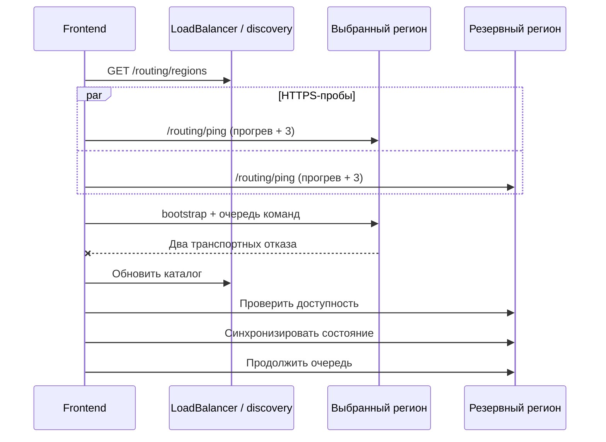

# Контракт discovery и маршрутизация

`GET /routing/regions` возвращает `{version:1, ttlSeconds:60, regions:[{id,name,apiBaseUrl,status,apiVersion,releaseId,compatibleFrontendRevisions}]}`. Внутренний `readyUrl` хранится только в конфигурации discovery. Адреса получают из inventory; клиент не принимает адрес назначения из query string или localStorage.

`GET /routing/ping` возвращает `{regionId,releaseId,apiVersion:1}`. Проба не использует PostgreSQL/Redis. Готовность региона отдельно определяется `/ready`, а фактическая версия — `/routing/ping`; несоответствие манифесту исключает регион из каталога. Discovery обновляет состояние каждые пять секунд, при ошибке конфигурации выдаёт пустой каталог, при устаревании состояния отвечает 503.

`POST /routing/report` принимает `{regionId,rttMs?}`. Это необязательная анонимная диагностика с ограничением частоты; клиентские значения считаются недоверенными, набор меток Prometheus ограничен. Авторизация, пользовательские идентификаторы и игровые данные не передаются.

`HttpGameApi` сохраняет очередь и ключ идемпотентности повтора. Маршрут и тело одной попытки закреплены. Незавершённая команда не рассылается по площадкам; неизвестный результат неидемпотентного POST проверяется до нового действия. `401`, `409`, `422` не вызывают failover, `429` не обходится сменой региона. После смены маршрута перед новой командой запрашивается актуальный snapshot. При потере записей PostgreSQL во время асинхронного failover сохранность истории идемпотентности не гарантируется.

Для образа frontend обязательны `VITE_API_URL=/`, `VITE_REGIONAL_ROUTING=1`, `VITE_ROUTING_ZONE` и полный `VITE_FRONTEND_REVISION`. Это публичные параметры сборки. Значение `X-Frontend-Revision` проверяется API в production. Не кэшируйте `/routing/*`, не включайте их в Service Worker precache.

LoadBalancer проверяет **`/lb-ready`**, который учитывает локальный статус discovery и draining. Региональные адреса закрепляются за площадками через DNS/ingress; общий адрес может балансироваться между площадками. Публичные `/internal/*` и `/metrics` закрыты. Межузловые метрики доступны на WireGuard-IP:9443, опубликованном только HA-профилем.
